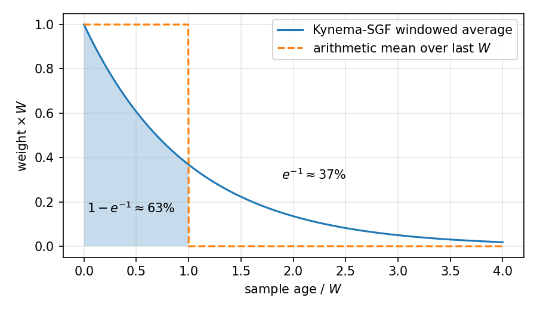
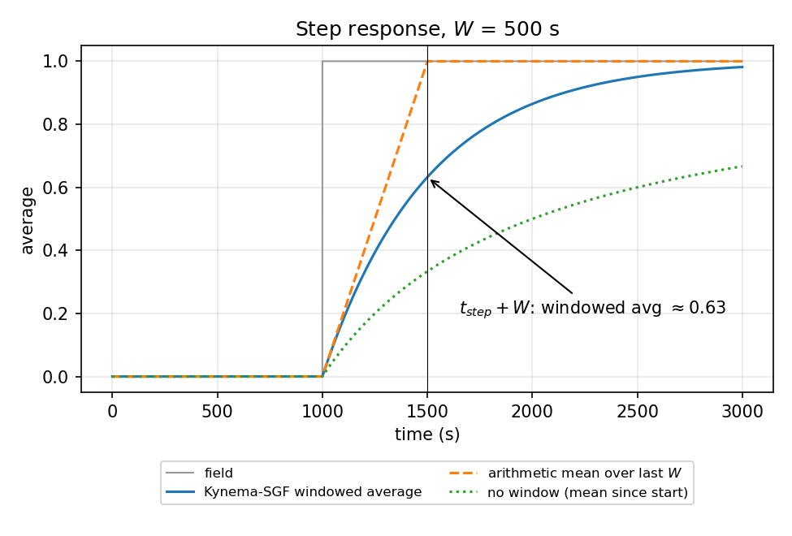

.. _inputs_averaging:
   
Section: Averaging
~~~~~~~~~~~~~~~~~~

This section controls data-averaging actions supported within
Kynema-SGF. 
Averaging is included as one of the identifiers of 
post-processing by
``incflo.post_processing = averaging``.
Time-averaging can be done to compute the means of any variable and 
is denoted by ``ReAveraging``. The code will add the prefix ``_mean`` 
to any variable that is time-averaged.
Reynolds stresses can also be computed using the ``ReynoldsStress`` averaging 
type.
Note that to compute the Reynolds stresses, the mean of the velocity
field is required.

.. input_param:: averaging.averaging_window

   **type:** Real, optional, default = huge number (no window)
   
   Specify the averaging window over which the time-averaging is done.
   When no window is given, the result is the arithmetic time mean over
   the entire averaging period. When a window is given, the average is
   an exponentially weighted moving average, **not** an arithmetic mean
   over the last ``averaging_window`` of simulation time. See
   :ref:`inputs_averaging_window` for details.

.. input_param:: averaging.averaging_start_time

   **type:** Real, optional, default = 0

   Specify the time to start computing averages.

.. input_param:: averaging.averaging_stop_time

   **type:** Real, optional, default = simulation end time

   Specify the time to stop time-averaging.

.. input_param:: averaging.averaging_time_interval

   **type:** Real, optional, default = -1. (off)

   Specify an interval of simulation time at which to do averaging.
   This allows for the averaging to take place only at instances
   that correspond to the averaging interval, which can be useful
   for phase averaging in contexts like periodic domains, regular
   waves, or fixed rotor speed simulations. When used with an
   averaging start time, the interval starts relative to the
   averaging start time.

Example::

   incflo.post_processing = averaging

   averaging.type = TimeAveraging
   averaging.labels = means  stress

   averaging.averaging_window = 10.0
   averaging.averaging_start_time = 0.0

   averaging.means.fields = velocity
   averaging.means.averaging_type = ReAveraging

   averaging.stress.fields = velocity
   averaging.stress.averaging_type = ReynoldsStress

.. _inputs_averaging_window:

Behavior of the averaging window
""""""""""""""""""""""""""""""""

Let :math:`t_0` be ``averaging_start_time``, :math:`W` be
``averaging_window`` (a duration in seconds), and :math:`t` be the
current simulation time, so that :math:`t - t_0` is how long averaging
has been running. The behavior of ``ReAveraging`` has two regimes:

- **Averaging has run for no longer than** :math:`W`
  (:math:`t - t_0 \le W`): the average is the arithmetic mean of all
  samples since :math:`t_0`. The window has no effect yet. This is also
  the behavior for the whole run if ``averaging_window`` is not set.
- **Averaging has run for longer than** :math:`W`
  (:math:`t - t_0 > W`): the average is no longer a plain mean. Each
  update is

  .. math::

     \bar{f}_{new} = \bar{f}_{old}\left(1 - \frac{\Delta t}{W}\right) + f\,\frac{\Delta t}{W}

  where :math:`\bar{f}_{old}` is the previous average, :math:`f` is the
  current field value, and :math:`\Delta t` is the time since the last
  averaging update.

This is an exponentially weighted moving average (a first-order
low-pass filter with time constant :math:`W`): a sample of age :math:`a`
has weight proportional to :math:`e^{-a/W}`, and old samples are
down-weighted but never dropped. This form is used because:

- it only stores the current average, whereas an arithmetic mean over
  the last :math:`W` seconds would require keeping every time step in
  the window in memory for the entire domain, and
- recent samples count more, so the mean follows a slowly varying
  background trend instead of being dominated by old data.

   Weight given to a sample as a function of its age, for the windowed
   average in Kynema-SGF (solid) and for an arithmetic mean over the
   last :math:`W` seconds (dashed). Only about 63% of the weight comes
   from the last :math:`W` seconds; the remaining 37% comes from older
   samples.

.. important::

   The windowed average is **not** the arithmetic mean over the last
   :math:`W` seconds. For example, with ``averaging_window = 500`` and
   ``averaging_start_time = 0``, suppose a field steps from 0 to 1 at
   :math:`t = 1000` s. The mean over :math:`(1000, 1500]` is 1, but the
   windowed average at :math:`t = 1500` s is only about 0.63, as shown
   below.

   Response of the average to a field that steps from 0 to 1 at
   :math:`t = 1000` s, with :math:`W = 500` s. One window after the step,
   the windowed average has only reached
   :math:`1 - e^{-1} \approx 0.63`, whereas an arithmetic mean over the
   last :math:`W` seconds would have reached 1.

To obtain an arithmetic mean over a period of interest, omit
``averaging_window`` and bound the period with ``averaging_start_time``
and ``averaging_stop_time``.

  

